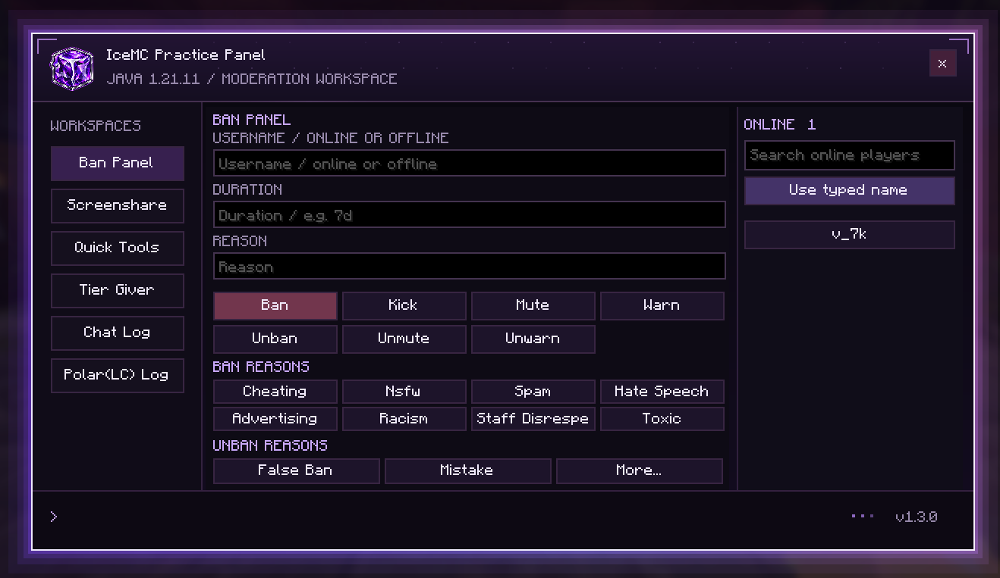

<div align="center">


# 💜 IceMC Practice Panel

### YOUR SERVER. YOUR WORKSPACE. YOUR CONTROL.

A purple-powered moderation workspace for **Minecraft Java Edition**.


[**Explore Features**](#-built-for-the-way-you-moderate) · [**Installation**](#-get-started) · [**Supported Versions**](#-supported-versions) · [**Join Discord**](https://discord.gg/avYXudUaG)

**SERVER IP** · `icemc.pro`

[](https://discord.gg/avYXudUaG)

</div>

---

## ✦ One panel. Six workspaces.

**IceMC Practice Panel**, also known as **IridiumX Panel**, brings everyday staff actions into a native, client-side Fabric interface. Moderate players, manage tiers, use quick tools, and review player chat or Polar(LC) alerts without repeatedly typing commands.

A dark purple workspace, animated outer glow, smooth transitions, and automatic GUI scaling keep everything within reach. Built for the **IceMC** staff workflow by **_0xi1**.

<div align="center">



**Press `Right Shift` → select a workspace → take action.**

</div>

## ⚡ Built for the way you moderate

| Workspace | What you can do |
| :--- | :--- |
| 🛡️ **Ban Panel** | Ban, kick, mute, warn, unban, unmute, and unwarn. Enter a duration, choose a reason preset, or write your own. Dedicated unban reasons include **False Ban** and **Mistake**. |
| 🖥️ **Screenshare** | Start or stop a screenshare workflow with its own player and reason fields. |
| ✨ **Quick Tools** | Switch gamemode, use vanish, give or clear invisibility, teleport, bring players, and send a custom command. |
| 👑 **Tier Giver** | Choose from **15 tiers** — HT, MT, and LT across levels 1–5. Assign or replace a LuckPerms suffix with `setsuffix`, or remove it with `removesuffix`. |
| 💬 **Chat Log** | Review captured player chat with timestamps. Search by player or message, scroll through history, jump to the latest entry, and clear the log. |
| 🔎 **Polar(LC) Log** | Keep captured Polar(LC) alerts and related punishment messages in a dedicated searchable log. |

### Small details that make a difference

- **Click a username to copy it** directly from either log.
- **Persistent history** keeps up to **2,000 entries per log** across restarts.
- **Online player search** fills the current workspace's username input.
- **Offline targets** are supported by moderation commands where the server allows them; Ban and Unban also accept UUIDs.
- **Bedrock-style names** such as `.stave` and `.icemc` are accepted in player inputs.
- **Automatic scaling** adapts the panel to the available GUI space.
- **Purple glow and animations** frame the workspace while keeping the content readable.
- **Saved inputs** preserve section preferences between sessions.

## 🧩 Supported versions

**This release supports Minecraft 1.21.11 through 26.2 only**, using a separate JAR for each listed release.

| Minecraft Java | Mod version | Java runtime | Fabric API used for build |
| :--- | :--- | :--- | :--- |
| **1.21.11** | `1.3.0+1.21.11` | Java **21+** | `0.141.6+1.21.11` |
| **26.1** | `1.3.0+26.1` | Java **25+** | `0.145.1+26.1` |
| **26.1.1** | `1.3.0+26.1.1` | Java **25+** | `0.145.4+26.1.1` |
| **26.1.2** | `1.3.0+26.1.2` | Java **25+** | `0.155.3+26.1.2` |
| **26.2** | `1.3.0+26.2` | Java **25+** | `0.161.0+26.2` |

**Required:** Fabric Loader **0.19.5+** and **Fabric API for your exact Minecraft version**. No additional client mods are required. Snapshots, prereleases, and versions earlier than 1.21.11 are outside this release's support range.

## 🚀 Get started

1. Install **Fabric Loader 0.19.5 or newer** for a supported Minecraft version.
2. Install **Fabric API** for that same version.
3. Download the matching **IceMC Practice Panel v1.3.0 JAR** from this repository's releases.
4. Put both JARs in your Minecraft instance's `mods` folder. Keep only **one** version of the panel installed.
5. Launch Minecraft, join **`icemc.pro`**, and press **`Right Shift`**.

```text
Example: Minecraft 1.21.11

mods/
├── fabric-api-0.141.6+1.21.11.jar
└── iridiumx-panel-1.3.0+1.21.11.jar
```

The opening key can be changed in Minecraft's **Controls → Key Binds** menu.

> **Server permissions still apply.** The panel sends commands using your own account. Your server must provide the relevant moderation, screenshare, vanish, and LuckPerms commands and grant you permission to use them.

<details>
<summary><strong>📂 Where are my settings and logs saved?</strong></summary>

Preferences and section inputs are stored in:

```text
config/iridiumx-panel.json
```

Chat and Polar(LC) history are stored in:

```text
config/iridiumx/history/
```

Each log has its own search and clear action. The logs record messages received by your client; they do not retrieve older server history.

</details>

<details>
<summary><strong>🔧 Command integrations</strong></summary>

| Action | Command integration |
| :--- | :--- |
| Moderation | `/lban`, `/lkick`, `/lmute`, `/lwarn`, `/lunban`, `/lunmute`, `/lunwarn` |
| Screenshare | `/ss <player> <reason>` and `/ss stop` |
| Teleport / Bring | `/tp` |
| Invisibility | `/effect give` and `/effect clear` |
| Tier management | `/lp user <player> meta setsuffix 0 "<suffix>"` and `/lp user <player> meta removesuffix 0` |

Available actions depend on your server's plugins, command syntax, and permissions.

</details>

<details>
<summary><strong>🧪 Compatibility checks</strong></summary>

The listed builds have been compiled against their matching Minecraft and Fabric API versions. Package metadata, Java bytecode versions, required assets, and production remapping have been checked, alongside shared behavior tests for input validation, tier commands, log persistence, search, username extraction, scaling, and glow geometry.

Full in-game behavior has not been verified across every listed version. If you report an issue, include your Minecraft version, Fabric Loader and Fabric API versions, panel version, and relevant client log or screenshot.

</details>

---

<div align="center">

### 💎 Iridium × IceMC

**Join the server** · `icemc.pro`  
**Meet the community** · [discord.gg/avYXudUaG](https://discord.gg/avYXudUaG)

Made by **_0xi1** · **IceMC Practice Panel v1.3.0**

</div>
